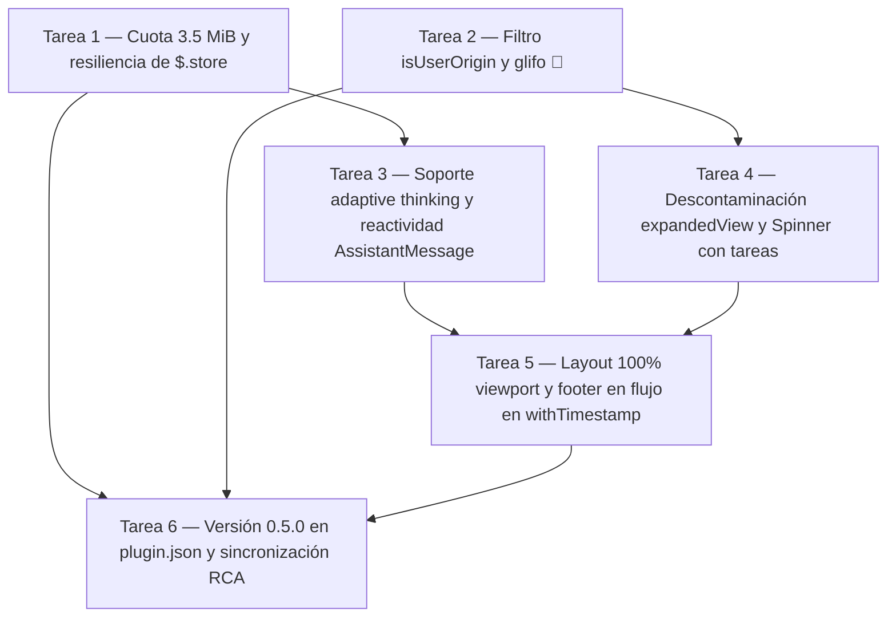

# Plan: Remediación integral de anomalías TUI, ciclo de vida y persistencia en `transcript-plus` v0.5.0

## Contexto del proyecto

`transcript-plus` (ubicado en `mods/transcript-plus/`) es un plugin de interfaz y ciclo de vida para **Claude Code CLI** (v2.1.287+, auditado sobre `claude.exe` v2.1.316) cargado mediante `CLAUDE_CODE_PLUGIN_DIRS`. Su implementación completa vive en un único módulo ESM sin dependencias externas (`mods/transcript-plus/hooks/register.js`, 805 líneas), declarado en `mods/transcript-plus/hooks/hooks.json`, con manifiesto en `mods/transcript-plus/.claude-plugin/plugin.json` y contrato de estado reactivo (`PluginState['transcript-plus'].second`) en `mods/transcript-plus/types/index.d.ts`. Los contratos del host están definidos en `mods/transcript-plus/.claude-plugin/types/claude-code/index.d.ts`.

El mod opera sobre dos ejes acoplados:
1. **Árbol de renderizado (`ui.render`):** El handler `withTimestamp` envuelve 7 componentes (`UserMessage`, `AssistantMessage`, `ToolUse`, `ToolResult`, `ToolGroup`, `CommandOutput`, `AskUserQuestion`) invocando `await next(e)` para obtener el nodo opaco del motor (`{ type: 'engine', ref: 0 }`) y rodeándolo con un `Box` de `borderStyle: 'round'`, un header con la hora de inicio (`🕐 h:mm:ss a.m./p.m. | Component`) y un footer con la duración atribuida al actor (`🔌` hooks pre-turno en `UserMessage`, `🧠` modelo en `AssistantMessage` y `ToolUse`, `🔧` herramienta/comando en `ToolResult`, `ToolGroup` y `CommandOutput`, `👤` usuario en `ToolResult` de `AskUserQuestion`). Los componentes `Spinner` y `TurnDuration` usan handlers dedicados (`withSpinner`, `withTurnDuration`) que prefijan la hora en `props.word` y `props.message`. Mientras una herramienta o grupo sigue abierto, `ToolUse` y `ToolGroup` muestran un contador en vivo (`🔧 Ns…`) sincronizado al cruce de cada segundo por `scheduleClock` (`$.clock.after`) y suscripción selectiva a `$.state.get({ plugin: 'transcript-plus', key: 'second' })`.
2. **Fijación de tiempos por eventos y persistencia:** Los 7 hooks de ciclo de vida (`prompt.submit`, `turn.start`, `turn.step`, `tool.call`, `command.run`, `session.append`, `turn.complete`) fijan la hora de inicio y la duración en el mapa `blocks` en el instante del evento (`pinTiming`), nunca en el render, aislando el estado por agente (`e.agentId ?? 'main'`). Las claves fijadas (`e.uuid` para filas del transcript, `u:<id>` para escritura de `ToolUse`, `r:<id>` para ejecución de `ToolResult`, `g:<id1>` para `ToolGroup`) se persisten con *debounce* de 1 segundo (`markForSave` / `flush`) en `$.store` bajo buckets diarios (`days/AAAA-MM-DD`).

Hechos e invariantes verificados del motor de Claude Code (`index.d.ts` y `claude.exe` v2.1.316):
- El motor rechaza la prop `width` en cualquier `Box` que envuelva un nodo `{ type: 'engine' }`, pero admite `flexGrow: 1` y espaciadores internos de `height: 0`.
- En `claude.exe`, `UserMessage` y `AssistantMessage` se montan dentro de `<Box flexDirection="column" width="100%">`, mientras que `ToolGroup` se monta dentro del envoltorio `iP` (`<Box>` con `flexDirection: "row"` por defecto y sin `width`).
- La función `Z$n` (`claude.exe:312023200`) inyecta `overflow: "hidden"` en cualquier render site que contenga algún descendiente con `position: "absolute"`.
- En el diferenciador ANSI (`claude.exe:298272900`), `NC(u.char)` devuelve `true` para codepoints en `129648..129791` (`U+1FA70..U+1FAFF`) y `129792..130047`, emitiendo saltos relativos `cursorTo` que en Windows ConPTY comen el espacio tras `🪝` (`U+1FA9D` = `129693`) y desfasan el cursor. El icono `🔌` (`U+1F50C` = `128268`) y el resto de iconos del mod (`🕐` = `128336`, `🔧` = `128295`, `🧠` = `129504`, `👤` = `128100`) tienen codepoints `< 129648` (`NC = false`).
- `$.store.set` rechaza cualquier escritura cuando el JSON total serializado del store del plugin supera **4 MiB (`4_194_304` bytes)** (`index.d.ts:3480`).

## Tabla de contenidos

- Contexto del proyecto
- Consideraciones fundamentales para el razonamiento y diseño del plan
- Propósito del plan
- Objetivos del plan
- Fase de ejecución
  - Tarea 1 — Saneamiento de cuota por presupuesto de bytes y resiliencia de escritura en `mods/transcript-plus/hooks/register.js`
  - Tarea 2 — Filtrado de origen de prompts y reemplazo del glifo de hooks en `mods/transcript-plus/hooks/register.js`
  - Tarea 3 — Soporte de bloques de narración (*adaptive thinking*) y reactividad de `AssistantMessage` en `mods/transcript-plus/hooks/register.js`
  - Tarea 4 — Descontaminación de `expandedView` y preservación del reloj en `withSpinner` con tareas activas en `mods/transcript-plus/hooks/register.js`
  - Tarea 5 — Estabilización geométrica de `ToolGroup` al 100% del viewport y migración del footer a flujo en `mods/transcript-plus/hooks/register.js`
  - Tarea 6 — Actualización de metadatos de versión y sincronización documental en `mods/transcript-plus/.claude-plugin/plugin.json`
- Dependencias y orden de ejecución
- Fase de cierre

## Consideraciones fundamentales para el razonamiento y diseño del plan

1. **Madurez y dependientes:** El mod se ejecuta en producción local sobre sesiones activas de Claude Code cuyo archivo de almacenamiento (`~/.claude/plugins/store/transcript-plus_inline-f6bcfe55deb3.json`) acumula actualmente `62.801` entradas (`4.194.268` bytes en JSON compacto, a solo `36` bytes del tope de 4 MiB). En consecuencia, la poda por presupuesto de bytes (`MAX_STORE_BYTES = 3_670_016`, 3,5 MiB) debe ejecutarse tanto en `loadStore($)` al arrancar como en `flush($)` antes de escribir, desalojando los buckets `days/AAAA-MM-DD` más antiguos (FIFO) para recuperar margen en el archivo real de inmediato y sin borrar las entradas recientes ni las claves `u:`, `r:`, `g:` requeridas por `--resume` y `ctrl+o`.
2. **Estado canónico:** Tras la implementación deben permanecer sincronizados el código y los comentarios arquitectónicos de `mods/transcript-plus/hooks/register.js`, el manifiesto `mods/transcript-plus/.claude-plugin/plugin.json` (versión `"0.5.0"` y descripción actualizada con `🔌`) y el estado del documento `mods/transcript-plus/docs/issues/root-cause-analysis-v0.4.1.md`. No debe subsistir en el repositorio ninguna ocurrencia del carácter `🪝` (`U+1FA9D`) en código ni en el manifiesto, ni ningún nodo con `position: 'absolute'` en `withTimestamp`.

## Propósito del plan

En `transcript-plus` v0.4.1 convergen siete causas raíz estructurales (CR-1 a CR-7) documentadas en `mods/transcript-plus/docs/issues/root-cause-analysis-v0.4.1.md`: contracción brusca del ancho de `ToolGroup` de 152 a 41 columnas al desmontarse su subfila en vivo junto con recorte `overflow: "hidden"` inducido por el footer absoluto (CR-1), solapamiento de cursor en Windows ConPTY por el codepoint `U+1FA9D` del emoji `🪝` y congelación de residuos al cruzar `scrolledOutRows` (CR-2), omisión de bloques de narración `type: "thinking"` con texto (`isSummary: true`) que deja mensajes intermedios del asistente sin footer `🧠` y provoca que el contador del `ToolGroup` previo siga corriendo y luego retroceda (CR-3), ausencia de reactividad e invalidación de render en `AssistantMessage` cuando su duración se fija tras el primer pintado (CR-4), bloqueo del 100% de las escrituras en `$.store` por saturación del límite de 4 MiB sin poda por tamaño (CR-5), atribución indebida de latencia de hooks de usuario a notificaciones `<task-notification>` de subagentes (CR-6), y contaminación global de `expandedView` por mensajes con *speaker label* junto con pérdida del prefijo `🕐` en `Spinner` cuando hay tareas `in_progress` (CR-7). Este plan prescribe las modificaciones exactas sobre el ciclo de vida, la capa de persistencia y el árbol Flexbox en flujo para entregar la versión `0.5.0`, logrando marcos de ancho invariante en la TUI, tiempos y contadores exactos en *adaptive thinking* y almacenamiento persistente autogestionado bajo cuota.

## Objetivos del plan

1. Restablecer y proteger las escrituras en `$.store` imponiendo un presupuesto máximo de `3.5 MiB` (`3_670_016` bytes) con desalojo FIFO de los buckets diarios más antiguos en `loadStore` y `flush`, complementado con captura `try/catch` y poda de emergencia (resuelve **CR-5**).
2. Reemplazar el glifo `🪝` (`U+1FA9D`) por `🔌` (`U+1F50C`, codepoint `128268` fuera de `NC`) y acotar la medición y el footer de `UserMessage` exclusivamente a envíos con `origin.kind === 'composer' || origin.kind === 'bridge'` (resuelve **CR-2** y **CR-6**).
3. Soportar bloques `thinking` con texto de narración (`isSummary: true`) en `onStep` y `onAppend` sin alterar los bloques `thinking` silenciosos (`thinking: ""`), cerrando `lastCall` a tiempo, respetando `e.props.isActive` en `ToolGroup` e invalidando `ui.render` al fijar la duración `🧠` de cada `AssistantMessage` (resuelve **CR-3** y **CR-4**).
4. Impedir la contaminación de `expandedView` fuera de `ctrl+o` filtrando las filas de origen y preservar el reloj `🕐` en `withSpinner` cuando `e.props.message === null` y existe una tarea `in_progress` creada con `TaskCreate`/`TaskUpdate` o `TodoWrite` (resuelve **CR-7**).
5. Fijar el ancho de todos los recuadros de `withTimestamp` (incluido `ToolGroup` al cerrarse) al 100% del viewport usando `flexGrow: 1` y un espaciador de `height: 0` calculado con `e.viewport?.columns - 2`, y migrar el footer a una fila en flujo (`marginTop: -1`) libre de `position: 'absolute'` (resuelve **CR-1** y **CR-2**).
6. Actualizar el manifiesto del plugin a la versión `0.5.0` y registrar el cierre de remediación en el documento RCA.

## Fase de ejecución

### Tarea 1 — Saneamiento de cuota por presupuesto de bytes y resiliencia de escritura en `mods/transcript-plus/hooks/register.js`

#### Propósito

El motor de Claude Code rechaza cualquier llamada a `$.store.set` cuando el tamaño total del store en texto JSON supera `4 MiB` (`4_194_304` bytes); dado que `loadStore` hoy solo purga días con antigüedad mayor a `RETENTION_DAYS = 30`, la acumulación de 62.801 claves en 16 días (`4.194.268` bytes) saturó la cuota y provoca que todas las llamadas a `flush($)` fallen silenciosamente (CR-5). Incorporar un registro en memoria del peso en bytes de cada bucket diario (`dayBuckets`), una rutina `enforceStoreBudget` que desaloje los días más antiguos (FIFO) cuando el total exceda `3.5 MiB` (`3_670_016` bytes) tanto al cargar el store como antes de escribir, y un bloque `try/catch` con poda de emergencia en `flush($)` sanea de inmediato el archivo existente y garantiza que las sesiones reanudadas (`--resume`) siempre cuenten con persistencia operativa.

#### Objetivos

- Mantener el peso serializado de `$.store` por debajo de `MAX_STORE_BYTES = 3_670_016` bytes eliminando en orden ascendente (`days/AAAA-MM-DD`) los días más antiguos tanto en `loadStore($)` como en `flush($)`.
- Preservar todas las claves (`u:`, `r:`, `g:` y UUIDs) dentro de los días retenidos para no degradar la vista `ctrl+o` en sesiones reanudadas.
- Proteger `flush($)` con `try/catch` para que, ante cualquier rechazo de `$.store.set`, desaloje el día más antiguo restante y reintente la escritura sin perder estabilidad.
- **Ruta de reversión:** Revertir los cambios de `loadStore`, `flush` y `dayBuckets` en `mods/transcript-plus/hooks/register.js` a la versión v0.4.1.

#### Acciones

1. **`mods/transcript-plus/hooks/register.js`** — sección `Registro de bloques y persistencia` (líneas `129-142`): añadir la constante `const MAX_STORE_BYTES = 3_670_016`, el mapa `const dayBuckets = new Map()` (`dayKey -> { data, bytes }`), la función `const bucketBytes = (key, data) => key.length + JSON.stringify(data).length + 4`, y la función `async function enforceStoreBudget($, keepDay)` que sume `b.bytes` de todas las entradas de `dayBuckets` y, mientras la suma supere `MAX_STORE_BYTES`, busque la primera clave ordenada cronológicamente (`[...dayBuckets.keys()].sort()`) distinta de `keepDay`, la elimine del store con `await $.store.delete(oldestKey)` y de `dayBuckets.delete(oldestKey)` (cortando el bucle si solo queda `keepDay`).
2. **`mods/transcript-plus/hooks/register.js`** — función `loadStore($)` (líneas `145-162`): reemplazar su implementación para que obtenga y ordene ascendentemente las claves `const dayKeys = (await $.store.keys()).filter(k => k.startsWith(DAY_PREFIX)).sort()`, elimine con `await $.store.delete(key)` aquellas con `key.slice(DAY_PREFIX.length) < cutoff`, cargue el resto en `dayBuckets.set(key, { data, bytes: bucketBytes(key, data) })`, ejecute `await enforceStoreBudget($)` para desalojar inmediatamente de disco los días más antiguos si el store supera 3,5 MiB, y finalmente recorra `dayBuckets.values()` poblando `blocks.set(blockKey, { time: h, duration: d, fromEvent: true })` cuando `!blocks.has(blockKey) || !blocks.get(blockKey).fromEvent`.
3. **`mods/transcript-plus/hooks/register.js`** — función `flush($)` (líneas `201-214`): actualizar el bucle de volcado para que ignore cualquier `blockKey` que no exista en `blocks`, fusione cada `[day, entries]` de `byDay` con `const base = dayBuckets.get(day)?.data ?? (await $.store.get(day)) ?? {}` creando `const merged = { ...base, ...entries }`, actualice `dayBuckets.set(day, { data: merged, bytes: bucketBytes(day, merged) })`, invoque `await enforceStoreBudget($, day)` y ejecute `await $.store.set(day, merged)` dentro de un bloque `try / catch` que, si falla, elimine el día más antiguo disponible en `(await $.store.keys()).filter(k => k.startsWith(DAY_PREFIX) && k !== day).sort()[0]` (tanto en `$.store` como en `dayBuckets`) y reintente `await $.store.set(day, merged)` una vez.

### Tarea 2 — Filtrado de origen de prompts y reemplazo del glifo de hooks en `mods/transcript-plus/hooks/register.js`

#### Propósito

El carácter `🪝` (`U+1FA9D`, codepoint `129693`) pertenece al bloque Unicode `129648..129791` (`U+1FA70..U+1FAFF`) que activa `NC(u.char) === true` en `claude.exe`, emitiendo secuencias `cursorTo` que en Windows ConPTY suprimen el espacio posterior (`🪝2.3s`) y desfasan el cursor (CR-2); asimismo, `onSubmit`, `onAppend` y `RESOLVER.UserMessage` procesan todos los eventos `prompt.submit` sin verificar `origin.kind`, atribuyendo tiempos de hooks de usuario a notificaciones `<task-notification>` de subagentes (CR-6). Sustituir `🪝` por `🔌` (`U+1F50C`, codepoint `128268` < `129648`, donde `NC` es `false`) y filtrar por `isUserOrigin(origin)` (`composer` o `bridge`) elimina la anomalía de cursor en ConPTY y asegura que las notificaciones de tareas solo muestren su hora de creación en el header sin footer de duración.

#### Objetivos

- Reemplazar el icono de hooks de `UserMessage` por `'🔌'` (`U+1F50C`), garantizando que los 5 iconos del mod tengan codepoints `< 129648`.
- Capturar `pendingSubmit` y `currentPrompt` en `onSubmit` y completar la duración pre-turno en `onAppend` exclusivamente cuando `origin?.kind === 'composer' || origin?.kind === 'bridge'`.
- Devolver en `RESOLVER.UserMessage` únicamente `{ time: entryFor(e.requestId).time }` (sin `duration` ni `icon`) cuando `!isUserOrigin(e.props.origin)`.
- **Ruta de reversión:** Revertir `isUserOrigin` y restaurar el literal de icono anterior en `onSubmit`, `onAppend` y `RESOLVER.UserMessage` dentro de `mods/transcript-plus/hooks/register.js`.

#### Acciones

1. **`mods/transcript-plus/hooks/register.js`** — sección `Hooks de ciclo de vida` (líneas `245-248`): añadir la función predicado `const isUserOrigin = origin => origin?.kind === 'composer' || origin?.kind === 'bridge'` inmediatamente después de `const agentOf = e => e.agentId ?? MAIN`.
2. **`mods/transcript-plus/hooks/register.js`** — función `onSubmit($, e, next)` (líneas `331-335`): envolver las asignaciones `pendingSubmit = Date.now()` y `currentPrompt = { submittedAt: pendingSubmit }` dentro de `if (isUserOrigin(e.origin))` antes de `return next(e)`.
3. **`mods/transcript-plus/hooks/register.js`** — función `onAppend($, e, next)`, rama `case 'prompt':` (líneas `471-478`): cambiar la condición a `if (!e.agentId && isUserOrigin(e.origin) && currentPrompt && currentPrompt.rowKey === undefined)` para completar el prompt humano, y en la rama `else` llamar a `pinTiming($, e.uuid, row)` fijando únicamente `{ time: now, persist: true }`.
4. **`mods/transcript-plus/hooks/register.js`** — objeto `RESOLVER`, propiedad `UserMessage` (líneas `567-569`): reemplazar su implementación por:
   - si `e.requestId === 'placeholder'`, devolver `{ time: pendingSubmit ?? Date.now() }`;
   - si `!isUserOrigin(e.props.origin)`, devolver `{ time: entryFor(e.requestId).time }`;
   - en caso contrario, devolver `{ ...entryFor(e.requestId), icon: '🔌' }`.

### Tarea 3 — Soporte de bloques de narración (*adaptive thinking*) y reactividad de `AssistantMessage` en `mods/transcript-plus/hooks/register.js`

#### Propósito

Cuando se activa `thinking: { type: "adaptive", display: "updates" }`, el modelo emite dos clases de bloques `thinking`: bloques internos silenciosos (`thinking: ""`, que preceden a herramientas dentro de un mismo `ToolGroup`) y bloques de narración con texto (`thinking: "Confirmé..."`, que el motor monta en UI como `AssistantMessage` con `isSummary: true` separando dos `ToolGroup`); actualmente `onStep` ignora todos los bloques `thinking` y `onAppend` filtra solo `b.type === 'text'`, dejando a los `AssistantMessage` de narración sin footer `🧠` y provocando que el `ToolGroup` anterior siga contando en vivo y retroceda al cerrarse (CR-3), a lo que se suma que `AssistantMessage` no invalida `ui.render` ni se suscribe cuando su duración se fija tras el primer render (CR-4). Tratar en `onStep` los bloques `thinking` que reciben texto no vacío como bloques visibles (cerrando `lastCall`, fijando `attributedStart` y registrándolos en `modelBlocks` mientras los `thinking` vacíos siguen cediendo su tiempo al bloque siguiente), extraer su texto en `onAppend` con invalidación `$.ui.invalidate('ui.render')`, respetar `e.props.isActive` en `ToolGroup` y suscribir `AssistantMessage` mientras no tenga duración resuelve de raíz tanto CR-3 como CR-4 sin romper el *thinking* tradicional.

#### Objetivos

- Distinguir en `onStep` los bloques `thinking` vacíos (internos) de los bloques `thinking` con texto: un `thinking` con `chunk.text.trim() !== ''` debe cerrar `lastCall.delete(agent)`, actualizar `transcript-plus.second`, tomar `attributedStart = previous?.last ?? stepStart`, actualizar `previous = b` y registrarse en `modelBlocks`; si un bloque `text` aparece después de un `thinking` en el mismo paso (modo no adaptativo), el `text` debe absorber el `attributedStart` del `thinking` previo y retirarlo de `modelBlocks`.
- Extraer en `textOf` tanto el texto de `b.type === 'text'` como el de `b.type === 'thinking'` (`b.thinking`), consumiendo el bloque correspondiente en `onAppend` (`case 'response'`), cerrando `lastCall.delete(agentOf(e))` e invocando `$.ui.invalidate('ui.render')` tras `pinTiming`.
- Respetar `e.props.isActive` en `group(calls, isActive)` y declarar `subscribed: blocks.get(e.requestId)?.duration === undefined` en `RESOLVER.AssistantMessage`.
- **Ruta de reversión:** Revertir los cambios de `onStep`, `textOf`, `onAppend`, `group` y `RESOLVER.AssistantMessage` en `mods/transcript-plus/hooks/register.js`.

#### Acciones

1. **`mods/transcript-plus/hooks/register.js`** — función `onStep($, e, next)` (líneas `376-414`): actualizar el registro de chunks dentro de `if (BLOCK_KINDS.has(chunk.kind))` de la siguiente manera:
   - al recibir el primer chunk de `chunk.index`, crear `b = { kind: chunk.kind, text: '', first: now, last: now, attributedStart: previous?.last ?? stepStart, visible: false }` en `byIndex`;
   - si `b.kind === 'tool'`, fijar `b.visible = true`, `previous = b` y agregar `b` a `modelBlocks.get(agent)`;
   - si `b.kind === 'text'` y `!b.visible`, comprobar si el bloque inmediatamente anterior `previous` en el mismo paso era `previous?.kind === 'thinking'`: de ser así, heredar `b.attributedStart = previous.attributedStart` y retirar ese `previous` de `modelBlocks.get(agent)` (para que en modo de *thinking* tradicional el bloque `text` incluya el tiempo del `thinking` previo); luego marcar `b.visible = true`, `previous = b`, ejecutar `lastCall.delete(agent)`, emitir `void $.state.set({ plugin: 'transcript-plus', key: 'second' }, now)` y agregar `b` a `modelBlocks.get(agent)`;
   - si `b.kind === 'thinking'` y `!b.visible && chunk.text.trim()`, marcar `b.visible = true`, fijar `b.attributedStart = previous?.last ?? stepStart`, actualizar `previous = b`, ejecutar `lastCall.delete(agent)`, emitir `void $.state.set({ plugin: 'transcript-plus', key: 'second' }, now)` y agregar `b` a `modelBlocks.get(agent)` (mientras que un `thinking` silencioso con `chunk.text === ''` permanece con `b.visible = false`, sin tocar `previous` ni `lastCall`);
   - en cada chunk, actualizar `b.last = now`, `if (chunk.kind === 'tool') b.toolId = chunk.id` y `if (chunk.kind === 'text' || chunk.kind === 'thinking') b.text += chunk.text`.
2. **`mods/transcript-plus/hooks/register.js`** — función `textOf` y rama `case 'response':` en `onAppend($, e, next)` (líneas `455` y `479-484`): reemplazar `textOf` por `const textOf = message => message.content.map(b => b.type === 'text' ? (b.text ?? '') : b.type === 'thinking' ? (b.thinking ?? '') : '').join('')`, y en `case 'response':` (cuando `text.trim()` no sea vacío):
   - limpiar `lastCall.delete(agentOf(e))`;
   - consumir el bloque con `const b = consumeBlock(agentOf(e), b => (b.kind === 'text' || b.kind === 'thinking') && b.text.trim() === text.trim())`;
   - fijar el tiempo con `pinTiming($, e.uuid, b ? { time: b.attributedStart, duration: b.last - b.attributedStart, persist: true } : row)`;
   - invocar `$.ui.invalidate('ui.render')` y `void $.state.set({ plugin: 'transcript-plus', key: 'second' }, now)` para redibujar de inmediato tanto el `AssistantMessage` como cualquier `ToolGroup` recién cerrado.
3. **`mods/transcript-plus/hooks/register.js`** — función `group` y `RESOLVER.ToolGroup` (líneas `533-553` y `594`): cambiar la firma a `function group(calls, isActive)` e invocarla desde `RESOLVER.ToolGroup` como `group(e.props.calls, e.props.isActive)`, reemplazando la línea `537` por `if (calls.some(c => c.isRunning || runningCalls.has(c.tool_use_id)) || (isActive !== false && awaitsAnotherCall(calls)))` para que un `ToolGroup` que el motor ya marcó con `isActive: false` cierre inmediatamente su contador.
4. **`mods/transcript-plus/hooks/register.js`** — objeto `RESOLVER`, propiedad `AssistantMessage` (línea `572`): reemplazar por `AssistantMessage: e => ({ ...entryFor(e.requestId), icon: '🧠', noMargin: expandedView, subscribed: blocks.get(e.requestId)?.duration === undefined })`.

### Tarea 4 — Descontaminación de `expandedView` y preservación del reloj en `withSpinner` con tareas activas en `mods/transcript-plus/hooks/register.js`

#### Propósito

En `withTimestamp`, la bandera `expandedView` se asigna hoy desde cualquier `UserMessage.props.isExpanded`, pero según `index.d.ts:10419-10420` dicha prop también es `true` fuera de `ctrl+o` en mensajes bajo *speaker label* (`e.props.from`), dejando `expandedView = true` y suprimiendo el `marginTop: -1` de los `AssistantMessage` posteriores; por otro lado, cuando `TaskCreate` registra una tarea con `activeForm` y luego `TaskUpdate` cambia su estado a `in_progress` (enviando solo `{ taskId, status: "in_progress" }`) o se usa `TodoWrite`, el componente nativo `Spinner` (`claude.exe:312071500`) prioriza `activeForm` sobre `props.word` cuando `e.props.message === null`, perdiendo el prefijo `🕐` (CR-7). Filtrar la actualización de `expandedView` y mantener un registro persistente en sesión de tareas por `taskId` (`taskRegistry`) y de `TodoWrite` (`todoActiveLabel`) para inyectar el texto activo con prefijo `🕐` en `withSpinner` soluciona ambos defectos.

#### Objetivos

- Actualizar `expandedView` exclusivamente cuando `e.component === 'UserMessage'` sea de origen humano sin `from` ni `task`, o desde `ToolResult` y `TurnDuration` cuando `typeof e.props.isExpanded === 'boolean'`.
- Correlacionar el `id` devuelto por `TaskCreate` (`out.result?.task?.id`) con su `activeForm ?? subject` en `taskRegistry`, y actualizar el estado en `TaskUpdate` (`e.input.taskId`, `e.input.status`) y en `TodoWrite` (`e.input.todos`) **antes** de `await next(e)` en `onToolCall`, conservando el registro entre turnos de la sesión.
- Inyectar `prefix + activeTaskLabel` en `props.message` dentro de `withSpinner` cuando `e.props.message === null` y exista una tarea `in_progress`.
- **Ruta de reversión:** Revertir `taskRegistry`, `todoActiveLabel`, `withSpinner` y el filtro de `expandedView` en `mods/transcript-plus/hooks/register.js`.

#### Acciones

1. **`mods/transcript-plus/hooks/register.js`** — sección `Hooks de ciclo de vida` y función `onToolCall($, e, next)` (líneas `314-319` y `428-443`):
   - declarar `const taskRegistry = new Map()` (`taskId -> { label, status }`), `let todoActiveLabel` y la función `const getActiveTaskLabel = () => todoActiveLabel ?? [...taskRegistry.values()].find(t => t.status === 'in_progress' && t.label)?.label ?? null`;
   - en `onToolCall`, **antes** de `await next(e)`:
     - si `e.tool === 'TodoWrite' && Array.isArray(e.input?.todos)`, buscar `const active = e.input.todos.find(t => t?.status === 'in_progress')` y asignar `todoActiveLabel = active ? (active.activeForm ?? active.content) : undefined`;
     - si `e.tool === 'TaskUpdate' && e.input?.taskId !== undefined`, obtener `const id = String(e.input.taskId)` y `const prev = taskRegistry.get(id) ?? {}`, actualizar `const label = e.input.activeForm ?? e.input.subject ?? prev.label` y `const status = e.input.status ?? prev.status`, y si `status === 'deleted'` ejecutar `taskRegistry.delete(id)`, o en caso contrario `taskRegistry.set(id, { label, status })`;
   - en `onToolCall`, **después** de `const out = await next(e)` (antes de devolver `out`):
     - si `e.tool === 'TaskCreate'`, extraer `const id = out?.result?.task?.id ?? /^Task #(\S+)/.exec(out?.text ?? '')?.[1]` y, si `id !== undefined`, registrar `taskRegistry.set(String(id), { label: e.input?.activeForm ?? e.input?.subject, status: e.input?.status ?? 'pending' })`.
2. **`mods/transcript-plus/hooks/register.js`** — funciones `withTimestamp` (línea `646`) y `withTurnDuration` (líneas `766-776`): reemplazar la línea `646` por:
   - `if (e.component === 'UserMessage' && isUserOrigin(e.props.origin) && !e.props.from && !e.props.task) expandedView = Boolean(e.props.isExpanded)`
   - `else if (e.component === 'ToolResult' && typeof e.props.isExpanded === 'boolean') expandedView = e.props.isExpanded`
   y añadir al inicio de `withTurnDuration` la línea `if (typeof e.props.isExpanded === 'boolean') expandedView = e.props.isExpanded`.
3. **`mods/transcript-plus/hooks/register.js`** — función `withSpinner($, e, next)` (líneas `748-760`): calcular `const baseMessage = e.props.message ?? getActiveTaskLabel()` y pasar `word: prefix + e.props.word` y `message: baseMessage === null ? null : prefix + baseMessage` en la llamada a `next`.

### Tarea 5 — Estabilización geométrica de `ToolGroup` al 100% del viewport y migración del footer a flujo en `mods/transcript-plus/hooks/register.js`

#### Propósito

En el motor de Claude Code, `ToolGroup` vive dentro del contenedor `iP` (`flexDirection: "row"` sin `width`), por lo que cuando concluyen sus herramientas y se desmonta su subfila activa (`wu`, que tenía `flexGrow: 1`), el marco cae de `e.viewport.columns` (152 columnas) a ~41 columnas y pierde 1 fila de altura; simultáneamente, el footer actual usa `position: "absolute"`, lo que dispara en `Z$n` (`claude.exe:312023200`) la inyección de `overflow: "hidden"` y corrompe el pintado diferencial al contraerse el bloque (CR-1 y CR-2). Dotar al `Box` raíz de `withTimestamp` de `flexGrow: 1`, fijar `minWidth` exactamente a `Math.max(0, e.viewport.columns - 2)` cuando `e.viewport?.columns` esté presente, y reestructurar el contenedor para que tanto el header (`column-reverse` + `marginBottom: -1`) como el footer (`column` + `marginTop: -1`) vayan en flujo sin `position: 'absolute'` mantiene todos los recuadros al 100% del ancho del viewport y elimina el recorte forzado.

#### Objetivos

- Impedir cualquier cambio de ancho en `ToolGroup` al cerrarse fijando `flexGrow: 1` en el `Box` raíz y `minWidth = e.viewport?.columns ? Math.max(0, e.viewport.columns - 2) : Math.max(headerText.length, footerText.length) + 2` en el espaciador `height: 0`, respetando también viewports estrechos (`< 42` columnas) sin desbordar la fila.
- Eliminar `position: 'absolute'` del footer en `withTimestamp` utilizando un `Box` exterior `flexDirection: 'column'` cuyo primer hijo sea el `Box` `column-reverse` (recuadro + header en flujo) y cuyo segundo hijo condicional sea el footer en flujo (`marginLeft: 2, marginRight: 2, marginTop: -1, justifyContent: 'flex-end'`).
- Actualizar todos los comentarios de `mods/transcript-plus/hooks/register.js` para reflejar la arquitectura de la versión `0.5.0`.
- **Ruta de reversión:** Revertir la función `withTimestamp` en `mods/transcript-plus/hooks/register.js` al árbol de v0.4.1.

#### Acciones

1. **`mods/transcript-plus/hooks/register.js`** — función `withTimestamp($, e, next)`, cálculo de `minWidth` (línea `697`): reemplazar `const minWidth = Math.max(headerText.length, footerText.length) + 2` por:
   ```js
   const minWidth = e.viewport?.columns
     ? Math.max(0, e.viewport.columns - 2)
     : Math.max(headerText.length, footerText.length) + 2
   ```
   asegurando que las `minWidth` celdas internas más las `2` celdas de los bordes verticales `│` sumen exactamente `e.viewport.columns` sin exceder nunca el ancho del terminal.
2. **`mods/transcript-plus/hooks/register.js`** — función `withTimestamp($, e, next)`, árboles de retorno (líneas `671-680` y `699-739`):
   - en la rama `if (b.dialog)`, añadir `flexGrow: 1` a `props` (`{ flexDirection: 'column', paddingTop: 1, flexGrow: 1 }`);
   - en el retorno general, devolver un `Box` raíz con `props: { flexDirection: 'column', paddingTop: 1, flexGrow: 1 }` cuyos `children` sean:
     1. un `Box` con `props: { flexDirection: 'column-reverse' }` y `children`:
        - `children[0]`: el `Box` con `props: { flexDirection: 'column', borderStyle: 'round' }` (conteniendo el `Box` del `tree` con `marginTop: b.noMargin ? 0 : -1` y el `Box` espaciador `height: 0, overflow: 'hidden'` con `' '.repeat(minWidth)`);
        - `children[1]`: el `Box` del header en flujo con `props: { marginLeft: 2, marginRight: 2, marginBottom: -1 }` y `children: [{ type: 'Text', props: { wrap: 'truncate' }, children: [headerText] }]`;
     2. cuando `footerText` no sea vacío, un segundo hijo en flujo con `props: { marginLeft: 2, marginRight: 2, marginTop: -1, justifyContent: 'flex-end' }` y `children: [{ type: 'Text', props: { wrap: 'truncate' }, children: [footerText] }]`.
3. **`mods/transcript-plus/hooks/register.js`** — bloques de comentarios documentales (líneas `1-102`, `118-128`, `337-338`, `565-566`, `605-644`, `661-665` y `682-696`): sustituir todas las referencias al icono `🪝` por `🔌`, documentar que tanto el header como el footer van en flujo sin `position: 'absolute'`, explicar la fijación de ancho completo mediante `flexGrow: 1` + `e.viewport?.columns - 2` y describir el límite de cuota `MAX_STORE_BYTES = 3.5 MiB`.

### Tarea 6 — Actualización de metadatos de versión y sincronización documental en `mods/transcript-plus/.claude-plugin/plugin.json`

#### Propósito

Una vez implementadas las correcciones de las siete causas raíz en `mods/transcript-plus/hooks/register.js`, el manifiesto `mods/transcript-plus/.claude-plugin/plugin.json` conservaría la versión `"0.4.1"` y el icono `🪝` en su descripción, mientras que el documento `mods/transcript-plus/docs/issues/root-cause-analysis-v0.4.1.md` seguiría reflejando un estado previo a la remediación. Actualizar el manifiesto a `"0.5.0"` con el icono `🔌` y dejar constancia de la resolución en el informe RCA asegura la consistencia canónica del módulo.

#### Objetivos

- Actualizar `version` a `"0.5.0"` y reemplazar `🪝 hooks` por `🔌 hooks` en `mods/transcript-plus/.claude-plugin/plugin.json`.
- Registrar el estado de remediación en la tabla de metadatos de `mods/transcript-plus/docs/issues/root-cause-analysis-v0.4.1.md`.
- **Ruta de reversión:** Restaurar `"version": "0.4.1"` y el texto previo en `mods/transcript-plus/.claude-plugin/plugin.json` y `mods/transcript-plus/docs/issues/root-cause-analysis-v0.4.1.md`.

#### Acciones

1. **`mods/transcript-plus/.claude-plugin/plugin.json`** — propiedades `version` y `description` (líneas `3-4`): reemplazar `"version": "0.4.1"` por `"version": "0.5.0"` y sustituir `🪝 hooks` por `🔌 hooks` en `description`.
2. **`mods/transcript-plus/docs/issues/root-cause-analysis-v0.4.1.md`** — tabla de metadatos (línea `10`): reemplazar el valor de `**Estado**` por `Diagnóstico completado y remediado en v0.5.0 — 7 Causas Raíz Estructurales Resueltas`.

## Dependencias y orden de ejecución



La numeración de las tareas (Tarea 1 a Tarea 6) constituye el orden recomendado de ejecución y es un orden topológico válido del grafo de dependencias:
- **Par inicial paralelizable (`Tarea 1` y `Tarea 2`):** Son mutuamente independientes; `Tarea 1` interviene exclusivamente la capa de almacenamiento (`loadStore`, `flush`, `dayBuckets`, `enforceStoreBudget`) y `Tarea 2` introduce `isUserOrigin` y el icono `🔌` en `onSubmit`, `onAppend` (`case 'prompt'`) y `RESOLVER.UserMessage`.
- **Par intermedio paralelizable (`Tarea 3` y `Tarea 4`):** `Tarea 3` depende de `Tarea 1` porque amplía las filas fijadas y persistidas desde `onAppend` (`case 'response'`); `Tarea 4` depende de `Tarea 2` porque emplea `isUserOrigin` para filtrar las actualizaciones de `expandedView`.
- **Secuencia final (`Tarea 5` $\rightarrow$ `Tarea 6`):** `Tarea 5` consolida el árbol Flexbox final de `withTimestamp` y la documentación interna de `mods/transcript-plus/hooks/register.js` tras los cambios en `RESOLVER` y `expandedView` de las tareas 3 y 4; por último, `Tarea 6` cierra el cambio actualizando la versión `"0.5.0"` en `mods/transcript-plus/.claude-plugin/plugin.json` y el estado del informe `mods/transcript-plus/docs/issues/root-cause-analysis-v0.4.1.md`.

## Fase de cierre

Al terminar la ejecución, redactar el **Recorrido (walkthrough)** post-ejecución como apertura del mensaje final, en español, con dos componentes en orden: (1) **Proceso seguido** — qué tareas se ejecutaron y en qué orden; (2) **Desviaciones respecto al plan** — toda divergencia entre el plan aprobado y la ejecución real (tareas adaptadas, acciones añadidas u omitidas, archivos o fuentes tocados fuera de las líneas de Acción planificadas, cambios de orden respecto al orden recomendado), cada una con su motivo; o una nota explícita de que la ejecución coincidió con el plan sin desviaciones. Esta fase no tiene Acciones ni produce mutaciones: prescribe el reporte que cierra la ejecución.